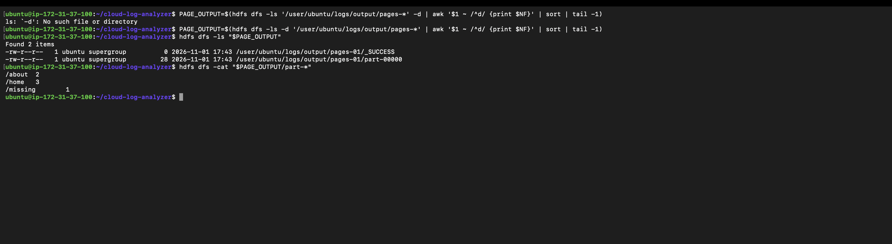
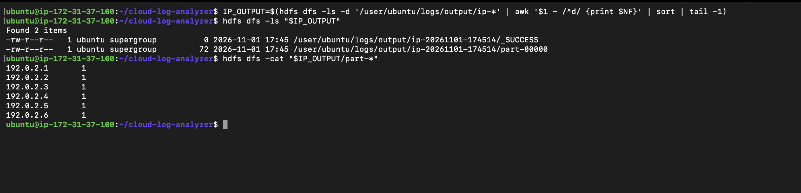
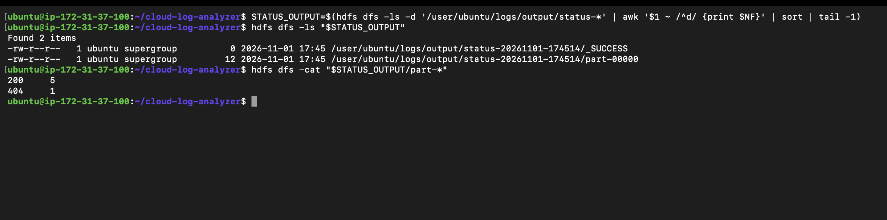

# Cloud-Based Web Log Analyzer using Hadoop MapReduce

## Objective and problem statement

Aggregate web requests by page, client IP, and HTTP status, then check the results against independently computed counts. Individual log records are difficult to summarize by inspection; key/count aggregation produces request-frequency reports and makes failed requests visible.

This project uses synthetic data and a single AWS EC2 instance with Hadoop 3.4.3, Java 11, and HDFS. The execution configuration supplied for this project is `dfs.replication=1` and `mapreduce.framework.name=local`. YARN was not configured. Python 3 scripts use only the standard library. These environment details describe the reported project setup; the saved TSV files alone do not establish the remote configuration or original submission commands.

## Actual file structure

```text
cloud-log-analyzer/
├── README.md
├── PROJECT_REPORT.md
├── SCREENSHOTS.md
├── screenshots/                 # Empty until evidence is captured
├── sample.log
├── large.log
├── generate_logs.py
├── mapper.py
├── reducer.py
├── verify_reports.py
├── results/
│   ├── pages.tsv
│   ├── ip.tsv
│   ├── status.tsv
│   └── large/
│       ├── pages.tsv
│       ├── ip.tsv
│       └── status.tsv
├── Macintosh HD                # Pre-existing item; left unchanged
└── .DS_Store                   # Pre-existing macOS metadata
```

| File or folder | Purpose |
| --- | --- |
| `sample.log` | Six synthetic requests: `/home` three times, `/about` twice, `/missing` once. |
| `generate_logs.py` | Uses seed 42 to write exactly 10,000 requests to `large.log` beside the script. |
| `large.log` | Generated dataset using 50 IPs (`192.0.2.1`–`192.0.2.50`), six pages, and statuses 200, 404, 500. |
| `mapper.py` | Emits `page<TAB>1`; rejects records without exactly four whitespace-separated fields and warns on stderr. It only counts pages. |
| `reducer.py` | Sums consecutive sorted `key<TAB>count` pairs; works for page, IP, or status keys; emits nothing on empty input. |
| `verify_reports.py` | Independently reads `large.log` using `collections.Counter`, then checks all keys/counts and the 10,000 total in each large report. Missing files, duplicate keys, invalid counts, and mismatches fail with a nonzero exit status. |
| `results/{pages,ip,status}.tsv` | Saved six-record sample reports. |
| `results/large/{pages,ip,status}.tsv` | Saved 10,000-record reports, verified against `large.log`. |
| `README.md` | Usage, data flow, commands, actual results, and limitations. |
| `PROJECT_REPORT.md` | Academic project report; student names remain placeholders. |
| `SCREENSHOTS.md`, `screenshots/` | Evidence checklist and destination for future captures. No screenshots are supplied yet. |
| `Macintosh HD`, `.DS_Store` | Existing ancillary items, not analyzer inputs or dependencies; preserved. |

The record format is `IP timestamp page HTTP_status`. Large-data timestamps advance one second per record, from `2026-11-01T10:00:00` through `2026-11-01T12:46:39`. Every `/missing` request has status 404; other pages use 200 with a 5% probability of 500.

## Data flow

```text
synthetic logs → HDFS → Hadoop Streaming mapper → sorting/grouping
               → reducer → HDFS reports → local TSV exports → Counter verification
```

The page mapper produces page/count pairs. IP and status reports require selecting fields 1 and 4 respectively; separate IP/status mapper scripts are not present. The reproduction commands below supply those selections inline. Hadoop Streaming exchanges tab-separated keys and values with the Python processes, as described in the official [Streaming documentation](https://hadoop.apache.org/docs/r3.4.3/hadoop-streaming/HadoopStreaming.html). With `mapreduce.framework.name=local`, MapReduce tasks run locally on the EC2 host, while inputs and outputs use HDFS.

## Local tests and generation

Run from the project directory:

```sh
cd ~/cloud-log-analyzer
python3 mapper.py < sample.log | LC_ALL=C sort | python3 reducer.py
```

Expected and observed sample page output (tab-separated):

```text
/about	2
/home	3
/missing	1
```

Check empty input; both commands should report `0` bytes:

```sh
python3 mapper.py < /dev/null | LC_ALL=C sort | python3 reducer.py | wc -c
python3 reducer.py < /dev/null | wc -c
```

Generate the dataset and verify the saved reports:

```sh
python3 generate_logs.py
wc -l large.log
python3 verify_reports.py
```

Generation overwrites `large.log` with the deterministic seed-42 dataset; it does not create reports. The verifier reads the reports already in `results/large/`, independently of the mapper and reducer. Expected line count is `10000`. Successful report verification prints:

```text
PASS pages: every key and count matches; total = 10000
PASS ip: every key and count matches; total = 10000
PASS status: every key and count matches; total = 10000
```

## Hadoop execution commands

The original EC2 shell transcript and Hadoop configuration files are not included. The following are concrete reproduction commands for the stated setup, not a claim to recover the historical invocation. They were not executed while writing this documentation. Run them on the already configured EC2 instance with Python 3, Java 11, Hadoop 3.4.3, and HDFS available, and `HADOOP_HOME`/`JAVA_HOME` configured. Do not format an existing NameNode. See the official [single-node setup guide](https://hadoop.apache.org/docs/r3.4.3/hadoop-project-dist/hadoop-common/SingleCluster.html) for prerequisites.

Inspect the environment and running HDFS services:

```sh
cd ~/cloud-log-analyzer
python3 --version
java -version
hadoop version
jps
hdfs getconf -confKey fs.defaultFS
hdfs getconf -confKey dfs.replication
hdfs dfsadmin -report
```

Use a fresh HDFS run directory and a separate local export directory to preserve saved evidence. The configured `fs.defaultFS` must be an HDFS URI. The loop below submits three Streaming jobs, selecting pages with the existing mapper and IP/status with inline Python. One reducer writes one part file per report. Generic options precede Streaming options, following the official [Streaming command syntax](https://hadoop.apache.org/docs/r3.4.3/hadoop-streaming/HadoopStreaming.html).

```bash
# Run this block in Bash; no AWS connection or cluster setup is performed here.
set -euo pipefail
cd ~/cloud-log-analyzer
HDFS_URI=$(hdfs getconf -confKey fs.defaultFS)
case "$HDFS_URI" in
  hdfs://*) ;;
  *) echo 'Configure fs.defaultFS to use HDFS before submission.' >&2; exit 1 ;;
esac
RUN_ID=$(python3 -c 'import uuid; print(uuid.uuid4().hex)')
HDFS_RUN="/user/$(id -un)/cloud-log-analyzer/runs/$RUN_ID"
EXPORT_DIR="results/reproduced-$RUN_ID/large"
hdfs dfs -mkdir -p "$HDFS_RUN/input"
hdfs dfs -put large.log "$HDFS_RUN/input/large.log"
hdfs dfs -setrep -w 1 "$HDFS_RUN/input/large.log"
mkdir -p "$EXPORT_DIR"

for report in pages ip status; do
  case "$report" in
    pages) mapper_command='python3 mapper.py' ;;
    ip) field=0 ;;
    status) field=3 ;;
  esac
  if [ "$report" != pages ]; then
    mapper_command="python3 -c 'import sys; [print(f[$field]+chr(9)+str(1)) for f in map(str.split,sys.stdin) if len(f)==4]'"
  fi
  mapred streaming \
    -D "fs.defaultFS=$HDFS_URI" \
    -D dfs.replication=1 \
    -D mapreduce.framework.name=local \
    -D mapreduce.job.reduces=1 \
    -files "file://$PWD/mapper.py,file://$PWD/reducer.py" \
    -input "$HDFS_RUN/input/large.log" \
    -output "$HDFS_RUN/$report" \
    -mapper "$mapper_command" \
    -reducer 'python3 reducer.py'
  hdfs dfs -cat "$HDFS_RUN/$report/part-*" > "$EXPORT_DIR/$report.tsv"
  cmp "results/large/$report.tsv" "$EXPORT_DIR/$report.tsv"
done
python3 verify_reports.py
```

The `cmp` commands check new exports against the preserved, independently verified reports. `verify_reports.py` always reads `results/large/`; it does not automatically select the new export directory. No output directory is deleted or reused. HDFS upload, listing, and export use the official [File System Shell](https://hadoop.apache.org/docs/r3.4.3/hadoop-project-dist/hadoop-common/FileSystemShell.html) commands.

## Actual results

The existing reports were read and `python3 verify_reports.py` was run successfully during documentation preparation. All three reports matched independent counts for 10,000 records; every report totals 10,000. Page report: 6 keys. IP report: 50 keys. Status report: 3 keys.

### Pages — `results/large/pages.tsv`

| Page | Records |
| --- | ---: |
| `/about` | 1709 |
| `/contact` | 1677 |
| `/home` | 1689 |
| `/login` | 1649 |
| `/missing` | 1659 |
| `/products` | 1617 |

### HTTP statuses — `results/large/status.tsv`

| Status | Records |
| --- | ---: |
| `200` | 7915 |
| `404` | 1659 |
| `500` | 426 |

### IP addresses — `results/large/ip.tsv`

| IP | Records |
| --- | ---: |
| `192.0.2.1` | 211 |
| `192.0.2.10` | 185 |
| `192.0.2.11` | 221 |
| `192.0.2.12` | 213 |
| `192.0.2.13` | 200 |
| `192.0.2.14` | 169 |
| `192.0.2.15` | 174 |
| `192.0.2.16` | 174 |
| `192.0.2.17` | 180 |
| `192.0.2.18` | 209 |
| `192.0.2.19` | 201 |
| `192.0.2.2` | 183 |
| `192.0.2.20` | 183 |
| `192.0.2.21` | 209 |
| `192.0.2.22` | 200 |
| `192.0.2.23` | 175 |
| `192.0.2.24` | 211 |
| `192.0.2.25` | 217 |
| `192.0.2.26` | 198 |
| `192.0.2.27` | 209 |
| `192.0.2.28` | 203 |
| `192.0.2.29` | 189 |
| `192.0.2.3` | 185 |
| `192.0.2.30` | 182 |
| `192.0.2.31` | 209 |
| `192.0.2.32` | 205 |
| `192.0.2.33` | 180 |
| `192.0.2.34` | 200 |
| `192.0.2.35` | 225 |
| `192.0.2.36` | 209 |
| `192.0.2.37` | 221 |
| `192.0.2.38` | 189 |
| `192.0.2.39` | 195 |
| `192.0.2.4` | 178 |
| `192.0.2.40` | 198 |
| `192.0.2.41` | 204 |
| `192.0.2.42` | 186 |
| `192.0.2.43` | 208 |
| `192.0.2.44` | 218 |
| `192.0.2.45` | 212 |
| `192.0.2.46` | 206 |
| `192.0.2.47` | 209 |
| `192.0.2.48` | 219 |
| `192.0.2.49` | 212 |
| `192.0.2.5` | 207 |
| `192.0.2.50` | 210 |
| `192.0.2.6` | 195 |
| `192.0.2.7` | 200 |
| `192.0.2.8` | 215 |
| `192.0.2.9` | 209 |

The sample reports total six records each: pages `/about=2`, `/home=3`, `/missing=1`; six distinct IPs with one request each; statuses `200=5`, `404=1`.

## Screenshots

The existing captures below show the Hadoop/HDFS environment and the six-record sample run. They do not show the 10,000-record report verification. TIFF screenshots retain their original format; some Markdown viewers may require opening those image files directly.

### AWS EC2 deployment

No dedicated EC2 deployment screenshot is present. The Hadoop/HDFS capture below shows an EC2 internal hostname, but does not show the EC2 console or instance configuration.

### Hadoop installation and HDFS services


Hadoop reports version 3.4.3; `jps` lists NameNode and DataNode, and the HDFS report lists one live DataNode.

### Input logs in HDFS


The HDFS input directory contains `sample.log`, and `hdfs dfs -cat` displays its six records.

### Page counts



The sample page output contains `/about=2`, `/home=3`, and `/missing=1`; the directory listing includes `_SUCCESS` and `part-00000`.

### Requests per IP



The sample IP report contains six addresses, each with one request, alongside the HDFS output-file listing.

### HTTP status counts



The sample status report contains `200=5` and `404=1`; the HDFS listing includes the report part file and `_SUCCESS`.

### Verification of all three reports against 10,000 records

No screenshot of the 10,000-record verification is present. The existing sample-report captures above do not document that verification; its recorded results appear in the earlier validation and results sections.

## Limitations

- The data are synthetic and do not establish behavior on production traffic or varied log formats.
- The environment uses one EC2 instance and HDFS replication factor 1. There is no redundant data replica demonstrated here.
- `mapreduce.framework.name=local` runs computation locally; YARN was not configured. This is not a multi-node distributed execution benchmark.
- The mapper checks field count only. The reducer assumes valid integer counts and sorted input. No production ingestion or security features are implemented or evaluated.
- No execution-time, speedup, cost, recovery, or fault-tolerance measurements were collected in the supplied evidence.

The project demonstrates correctness of aggregation and independent validation. It does not demonstrate distributed performance or fault tolerance.

## References

- Apache Hadoop 3.4.3: [Hadoop Streaming](https://hadoop.apache.org/docs/r3.4.3/hadoop-streaming/HadoopStreaming.html).
- Apache Hadoop 3.4.3: [Setting up a Single Node Cluster](https://hadoop.apache.org/docs/r3.4.3/hadoop-project-dist/hadoop-common/SingleCluster.html).
- Apache Hadoop 3.4.3: [File System Shell](https://hadoop.apache.org/docs/r3.4.3/hadoop-project-dist/hadoop-common/FileSystemShell.html).
- Uploaded course slides: **[Add exact uploaded course slide title(s)]**. The slides and their titles were unavailable in this workspace when this documentation was written; this reference requires completion from the original upload.
