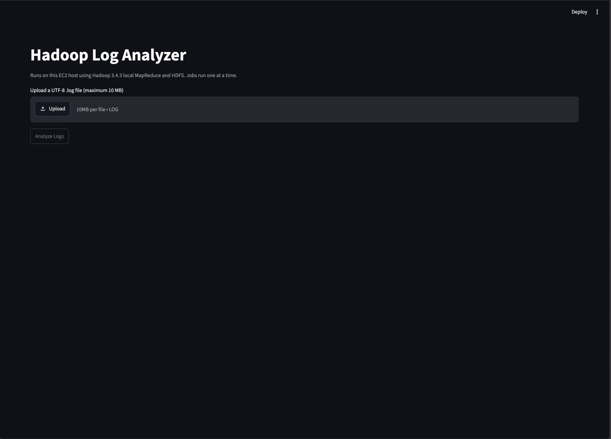
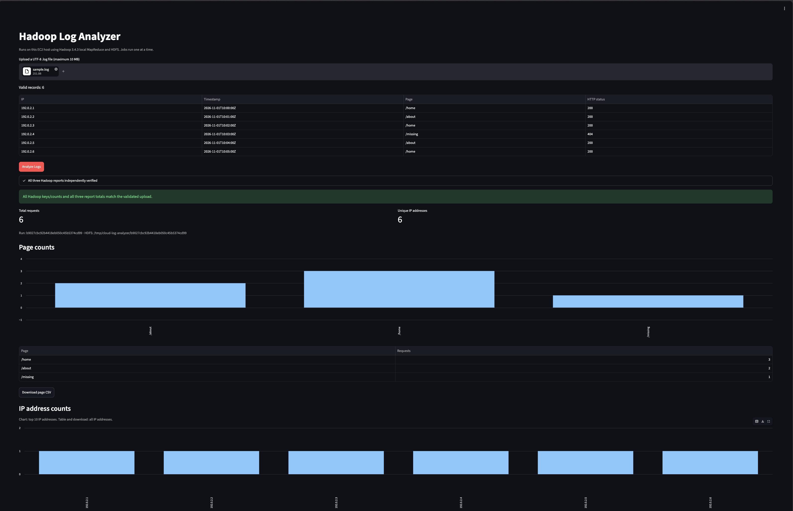
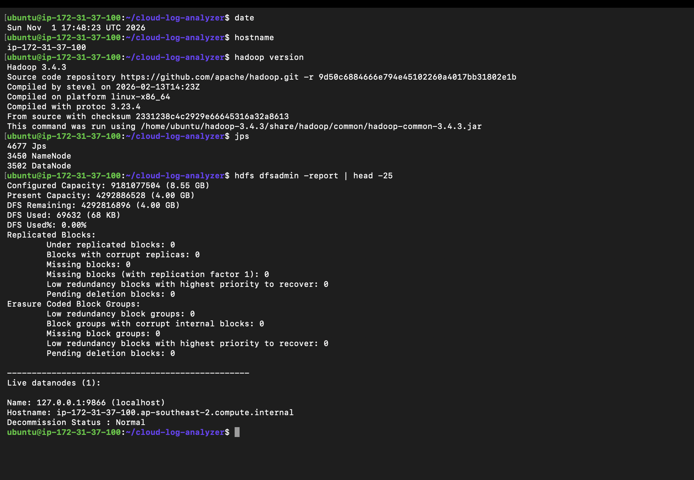
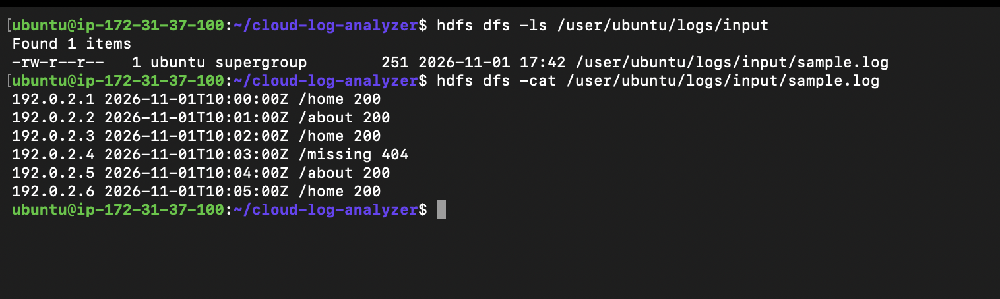

# Cloud-Based Web Log Analyzer using Hadoop MapReduce

## Objective and problem statement

Aggregate web requests by page, client IP, and HTTP status, then check the results against independently computed counts. Individual log records are difficult to summarize by inspection; key/count aggregation produces request-frequency reports and makes failed requests visible.

The working Streamlit upload-and-analysis application runs on a single AWS EC2 **c7i-flex.large instance with 4 GiB RAM**, using synthetic data, Python, Java 11, Hadoop 3.4.3, Hadoop Streaming, and HDFS. The scope is one EC2 instance and one DataNode with replication factor 1. The execution configuration supplied for this project is `dfs.replication=1` and `mapreduce.framework.name=local`. YARN was not configured. The original command-line Python 3 scripts use only the standard library; the Streamlit frontend adds the dependencies in `requirements.txt`. These environment details describe the reported project setup; the saved TSV files alone do not establish the remote configuration or original submission commands.

Repository: [harsha8876/cloud-log-analyzer](https://github.com/harsha8876/cloud-log-analyzer).

## Actual file structure

```text
cloud-log-analyzer/
├── README.md
├── PROJECT_REPORT.md          # Pre-existing Markdown report; preserved
├── SCREENSHOTS.md
├── screenshots/                
├── sample.log
├── large.log
├── generate_logs.py
├── mapper.py
├── reducer.py
├── verify_reports.py
├── app.py
├── log_pipeline.py
├── streaming_mapper.py
├── requirements.txt
├── tests/                     # Local backend and Streamlit checks
├── .gitignore
├── results/
│   ├── pages.tsv
│   ├── ip.tsv
│   ├── status.tsv
│   └── large/
│       ├── pages.tsv
│       ├── ip.tsv
│       └── status.tsv
├── Macintosh HD                # Pre-existing item; left unchanged
└── .DS_Store                   # Pre-existing macOS metadata
```

| File or folder | Purpose |
| --- | --- |
| `sample.log` | Six synthetic requests: `/home` three times, `/about` twice, `/missing` once. |
| `generate_logs.py` | Uses seed 42 to write exactly 10,000 requests to `large.log` beside the script. |
| `large.log` | Generated dataset using 50 IPs (`192.0.2.1`–`192.0.2.50`), six pages, and statuses 200, 404, 500. |
| `mapper.py` | Emits `page<TAB>1`; rejects records without exactly four whitespace-separated fields and warns on stderr. It only counts pages. |
| `reducer.py` | Sums consecutive sorted `key<TAB>count` pairs; works for page, IP, or status keys; emits nothing on empty input. |
| `verify_reports.py` | Independently reads `large.log` using `collections.Counter`, then checks all keys/counts and the 10,000 total in each large report. Missing files, duplicate keys, invalid counts, and mismatches fail with a nonzero exit status. |
| `results/{pages,ip,status}.tsv` | Saved six-record sample reports. |
| `results/large/{pages,ip,status}.tsv` | Saved 10,000-record reports, verified against `large.log`. |
| `README.md` | Usage, data flow, commands, actual results, and limitations. |
| `PROJECT_REPORT.md` | Pre-existing Markdown report; preserved unchanged. |
| `SCREENSHOTS.md`, `screenshots/` | Existing evidence checklist and supplied dashboard, sample-result, and Hadoop/HDFS captures. The inventory below identifies missing screenshots. |
| `Macintosh HD`, `.DS_Store` | Existing ancillary items, not analyzer inputs or dependencies; preserved. |

The record format is `IP timestamp page HTTP_status`. Large-data timestamps advance one second per record, from `2026-11-01T10:00:00` through `2026-11-01T12:46:39`. Every `/missing` request has status 404; other pages use 200 with a 5% probability of 500.

## Data flow

```text
Streamlit upload → record validation and preview → UUID storage on EC2 and HDFS
                → three Hadoop Streaming jobs (page, IP, status)
                → HDFS reports → independent Counter verification
                → charts and full tables → CSV report downloads
```

The page mapper produces page/count pairs. IP and status reports require selecting fields 1 and 4 respectively; separate IP/status mapper scripts are not present. The frontend uses `streaming_mapper.py` to select each field and invoke the existing page mapper. The command-line reproduction commands below supply the IP/status selections inline. Hadoop Streaming exchanges tab-separated keys and values with the Python processes, as described in the official [Streaming documentation](https://hadoop.apache.org/docs/r3.4.3/hadoop-streaming/HadoopStreaming.html). With `mapreduce.framework.name=local`, MapReduce tasks run locally on the EC2 host, while inputs and outputs use HDFS.

## Local tests and generation

Run from the project directory:

```sh
cd ~/cloud-log-analyzer
python3 mapper.py < sample.log | LC_ALL=C sort | python3 reducer.py
```

Expected and observed sample page output (tab-separated):

```text
/about	2
/home	3
/missing	1
```

Check empty input; both commands should report `0` bytes:

```sh
python3 mapper.py < /dev/null | LC_ALL=C sort | python3 reducer.py | wc -c
python3 reducer.py < /dev/null | wc -c
```

Generate the dataset and verify the saved reports:

```sh
python3 generate_logs.py
wc -l large.log
python3 verify_reports.py
```

Generation overwrites `large.log` with the deterministic seed-42 dataset; it does not create reports. The verifier reads the reports already in `results/large/`, independently of the mapper and reducer. Expected line count is `10000`. Successful report verification prints:

```text
PASS pages: every key and count matches; total = 10000
PASS ip: every key and count matches; total = 10000
PASS status: every key and count matches; total = 10000
```

## Hadoop execution commands

The original EC2 shell transcript and Hadoop configuration files are not included. The following are concrete reproduction commands for the stated setup, not a claim to recover the historical invocation. They were not executed while writing this documentation. Run them on the already configured EC2 instance with Python 3, Java 11, Hadoop 3.4.3, and HDFS available, and `HADOOP_HOME`/`JAVA_HOME` configured. Do not format an existing NameNode. See the official [single-node setup guide](https://hadoop.apache.org/docs/r3.4.3/hadoop-project-dist/hadoop-common/SingleCluster.html) for prerequisites.

Inspect the environment and running HDFS services:

```sh
cd ~/cloud-log-analyzer
python3 --version
java -version
hadoop version
jps
hdfs getconf -confKey fs.defaultFS
hdfs getconf -confKey dfs.replication
hdfs dfsadmin -report
```

Use a fresh HDFS run directory and a separate local export directory to preserve saved evidence. The configured `fs.defaultFS` must be an HDFS URI. The loop below submits three Streaming jobs, selecting pages with the existing mapper and IP/status with inline Python. One reducer writes one part file per report. Generic options precede Streaming options, following the official [Streaming command syntax](https://hadoop.apache.org/docs/r3.4.3/hadoop-streaming/HadoopStreaming.html).

```bash
# Run this block in Bash; no AWS connection or cluster setup is performed here.
set -euo pipefail
cd ~/cloud-log-analyzer
HDFS_URI=$(hdfs getconf -confKey fs.defaultFS)
case "$HDFS_URI" in
  hdfs://*) ;;
  *) echo 'Configure fs.defaultFS to use HDFS before submission.' >&2; exit 1 ;;
esac
RUN_ID=$(python3 -c 'import uuid; print(uuid.uuid4().hex)')
HDFS_RUN="/user/$(id -un)/cloud-log-analyzer/runs/$RUN_ID"
EXPORT_DIR="results/reproduced-$RUN_ID/large"
hdfs dfs -mkdir -p "$HDFS_RUN/input"
hdfs dfs -put large.log "$HDFS_RUN/input/large.log"
hdfs dfs -setrep -w 1 "$HDFS_RUN/input/large.log"
mkdir -p "$EXPORT_DIR"

for report in pages ip status; do
  case "$report" in
    pages) mapper_command='python3 mapper.py' ;;
    ip) field=0 ;;
    status) field=3 ;;
  esac
  if [ "$report" != pages ]; then
    mapper_command="python3 -c 'import sys; [print(f[$field]+chr(9)+str(1)) for f in map(str.split,sys.stdin) if len(f)==4]'"
  fi
  mapred streaming \
    -D "fs.defaultFS=$HDFS_URI" \
    -D dfs.replication=1 \
    -D mapreduce.framework.name=local \
    -D mapreduce.job.reduces=1 \
    -files "file://$PWD/mapper.py,file://$PWD/reducer.py" \
    -input "$HDFS_RUN/input/large.log" \
    -output "$HDFS_RUN/$report" \
    -mapper "$mapper_command" \
    -reducer 'python3 reducer.py'
  hdfs dfs -cat "$HDFS_RUN/$report/part-*" > "$EXPORT_DIR/$report.tsv"
  cmp "results/large/$report.tsv" "$EXPORT_DIR/$report.tsv"
done
python3 verify_reports.py
```

The `cmp` commands check new exports against the preserved, independently verified reports. `verify_reports.py` always reads `results/large/`; it does not automatically select the new export directory. No output directory is deleted or reused. HDFS upload, listing, and export use the official [File System Shell](https://hadoop.apache.org/docs/r3.4.3/hadoop-project-dist/hadoop-common/FileSystemShell.html) commands.

## Actual results

The application is working on AWS. In the verified **10,000-record test**, every key and count matched the independent Python Counter results in all three reports: page counts, requests per IP, and HTTP status counts. **Each report totaled 10,000 requests**. The dataset contains 50 unique IP addresses, six pages, and three HTTP status codes. The supplied frontend result screenshot shows the separate six-record sample run; a screenshot of the 10,000-record verification is still missing.

The existing reports were read and `python3 verify_reports.py` was run successfully during documentation preparation. All three reports matched independent counts for 10,000 records; every report totals 10,000. Page report: 6 keys. IP report: 50 keys. Status report: 3 keys.

### Pages — `results/large/pages.tsv`

| Page | Records |
| --- | ---: |
| `/about` | 1709 |
| `/contact` | 1677 |
| `/home` | 1689 |
| `/login` | 1649 |
| `/missing` | 1659 |
| `/products` | 1617 |

### HTTP statuses — `results/large/status.tsv`

| Status | Records |
| --- | ---: |
| `200` | 7915 |
| `404` | 1659 |
| `500` | 426 |

### IP addresses — `results/large/ip.tsv`

| IP | Records |
| --- | ---: |
| `192.0.2.1` | 211 |
| `192.0.2.10` | 185 |
| `192.0.2.11` | 221 |
| `192.0.2.12` | 213 |
| `192.0.2.13` | 200 |
| `192.0.2.14` | 169 |
| `192.0.2.15` | 174 |
| `192.0.2.16` | 174 |
| `192.0.2.17` | 180 |
| `192.0.2.18` | 209 |
| `192.0.2.19` | 201 |
| `192.0.2.2` | 183 |
| `192.0.2.20` | 183 |
| `192.0.2.21` | 209 |
| `192.0.2.22` | 200 |
| `192.0.2.23` | 175 |
| `192.0.2.24` | 211 |
| `192.0.2.25` | 217 |
| `192.0.2.26` | 198 |
| `192.0.2.27` | 209 |
| `192.0.2.28` | 203 |
| `192.0.2.29` | 189 |
| `192.0.2.3` | 185 |
| `192.0.2.30` | 182 |
| `192.0.2.31` | 209 |
| `192.0.2.32` | 205 |
| `192.0.2.33` | 180 |
| `192.0.2.34` | 200 |
| `192.0.2.35` | 225 |
| `192.0.2.36` | 209 |
| `192.0.2.37` | 221 |
| `192.0.2.38` | 189 |
| `192.0.2.39` | 195 |
| `192.0.2.4` | 178 |
| `192.0.2.40` | 198 |
| `192.0.2.41` | 204 |
| `192.0.2.42` | 186 |
| `192.0.2.43` | 208 |
| `192.0.2.44` | 218 |
| `192.0.2.45` | 212 |
| `192.0.2.46` | 206 |
| `192.0.2.47` | 209 |
| `192.0.2.48` | 219 |
| `192.0.2.49` | 212 |
| `192.0.2.5` | 207 |
| `192.0.2.50` | 210 |
| `192.0.2.6` | 195 |
| `192.0.2.7` | 200 |
| `192.0.2.8` | 215 |
| `192.0.2.9` | 209 |

The sample reports total six records each: pages `/about=2`, `/home=3`, `/missing=1`; six distinct IPs with one request each; statuses `200=5`, `404=1`.

## Screenshots

The supplied captures show the Streamlit dashboard, a verified six-record frontend run, and the Hadoop/HDFS environment and sample reports. PNG copies of the two TIFF screenshots are embedded for Markdown compatibility; original images and filenames are preserved.

### Streamlit upload dashboard



The dashboard offers a UTF-8 `.log` upload with a 10 MB limit; “Analyze Logs” is disabled before a valid upload.

### Verified sample analysis in Streamlit



The sample run shows six valid records, successful verification of all three reports, six requests and six unique IPs. Visible page counts are `/home=3`, `/about=2`, and `/missing=1`, followed by the page CSV button and IP chart.

### Missing screenshot evidence

- EC2 console showing the current `c7i-flex.large` instance type and 4 GiB RAM configuration.
- The 10,000-record frontend run with independent verification and request/IP metrics.
- The lower frontend sections showing the full IP table, HTTP status chart/table, and IP/status CSV buttons.
- Validation rejection and failed-job error states.

The application code provides the lower result sections and error handling; the supplied frontend capture does not show them.

### AWS EC2 deployment

No dedicated EC2 deployment screenshot is present. The Hadoop/HDFS capture below shows an EC2 internal hostname, but does not show the EC2 console or instance configuration.

### Hadoop installation and HDFS services



Hadoop reports version 3.4.3; `jps` lists NameNode and DataNode, and the HDFS report lists one live DataNode.

### Input logs in HDFS



The HDFS input directory contains `sample.log`, and `hdfs dfs -cat` displays its six records.

### Page counts


The sample page output contains `/about=2`, `/home=3`, and `/missing=1`; the directory listing includes `_SUCCESS` and `part-00000`.

### Requests per IP


The sample IP report contains six addresses, each with one request, alongside the HDFS output-file listing.

### HTTP status counts


The sample status report contains `200=5` and `404=1`; the HDFS listing includes the report part file and `_SUCCESS`.


## Streamlit frontend on EC2

The frontend must run **on the same EC2 instance as Hadoop**, using the existing Hadoop 3.4.3 installation and HDFS configuration. Running `app.py` on the Mac does not run Hadoop remotely. The app submits three real Hadoop Streaming jobs with `mapreduce.framework.name=local` and `mapreduce.job.reduces=1`. Computation runs locally on the EC2 host; this is not YARN execution or distributed MapReduce processing. Inputs and reports reside in HDFS.

Frontend files:

| File | Purpose |
| --- | --- |
| `app.py` | Upload, preview, progress, verified charts/tables, CSV downloads, and per-session results. |
| `log_pipeline.py` | Strict validation, environment/HDFS checks, process lock, isolated Hadoop jobs, and independent Counter comparison. |
| `streaming_mapper.py` | Selects page, IP, or status into the page position and calls the unchanged `mapper.py`; every job uses the unchanged `reducer.py`. |
| `requirements.txt` | Streamlit and pandas dependencies; Python 3.10 or later required. |
| `tests/test_frontend.py`, `tests/test_app.py` | Local validation, comparison, adapter, subprocess, isolation, and failure checks using unittest. Hadoop execution is mocked. |
| `.gitignore` | Excludes the virtual environment, Python cache, and frontend runtime files. |

Uploads must be UTF-8 `.log` files of at most 10 MiB (10 × 1024 × 1024 bytes). Every nonblank line must contain exactly `IP ISO_timestamp /page HTTP_status`, separated by whitespace. IPv4 and IPv6 are accepted. Timestamps require `YYYY-MM-DDTHH:MM:SS`, with optional fractional seconds and `Z` or `±HH:MM` timezone; dates without a time are rejected. Statuses must be three digits from 100 to 599. Invalid files show original line numbers (first 20 errors plus an additional-error count), and no job starts. Blank lines are ignored.

A valid upload shows its record count and first ten records. “Analyze Logs” checks Java and Hadoop executables from `JAVA_HOME` and `HADOOP_HOME`, the Hadoop version and Streaming JAR, an HDFS default filesystem, safe mode, and live DataNodes before uploading. It does not format HDFS, start services, or change Hadoop configuration.

Each analysis saves the original bytes to `.frontend-runs/<UUID>/upload.log` on EC2 and uploads to `/tmp/cloud-log-analyzer/<UUID>/input/upload.log` in HDFS. Each job gets its own new output directory beneath that UUID. Actual TSV reports are retrieved from HDFS only after successful job return and `_SUCCESS` checks, and saved beside the upload. Every output key/count must match independently computed Python Counters, and each report must total the uploaded record count. Only then are results published to the session. Total requests, unique IPs, page/status charts and full tables, the top ten IP chart, the full IP table, and all three CSV downloads use these verified Hadoop results.

Results persist through reruns and downloads. Changing or removing the uploaded content clears results and errors. Starting a new attempt clears prior results immediately, and any failed job or mismatch prevents success and result display. A nonblocking filesystem lock permits one frontend Hadoop run at a time across sessions/processes using this project directory. Use one deployed project directory on this small instance; separate copies or manually submitted jobs do not share the lock. Commands use argument lists with `shell=False`, checked exit codes, and 120-second utility/600-second job timeouts. A timed-out process group is terminated before the lock is released. Mapper/reducer commands explicitly invoke `python3`; uploaded names and contents never become commands or command arguments.

Runtime uploads and reports, including partial failed runs, are retained for diagnosis. Monitor EC2 and HDFS disk usage and remove only identified frontend UUID runs manually after they are no longer needed. The app never deletes existing datasets, reports, screenshots, or HDFS output directories.

### 1. Copy the frontend from the Mac

Use the instance's **current** public IP, which can change after an instance stop/start. These commands copy the new files and the two existing scripts required at runtime, without deleting other remote files. Run from the Mac:

```sh
cd ~/cloud-log-analyzer
ssh -i ~/Downloads/cloud-log-key.pem ubuntu@YOUR_CURRENT_EC2_PUBLIC_IP \
  'mkdir -p ~/cloud-log-analyzer/tests'
scp -i ~/Downloads/cloud-log-key.pem \
  app.py log_pipeline.py streaming_mapper.py mapper.py reducer.py requirements.txt README.md .gitignore \
  ubuntu@YOUR_CURRENT_EC2_PUBLIC_IP:~/cloud-log-analyzer/
scp -i ~/Downloads/cloud-log-key.pem tests/test_frontend.py tests/test_app.py \
  ubuntu@YOUR_CURRENT_EC2_PUBLIC_IP:~/cloud-log-analyzer/tests/
```

`sample.log` and `large.log` should already exist in the EC2 project for the tests below. If absent, copy them from the Mac using `scp` to that directory; preserve any existing EC2 datasets. Do not copy the Mac virtual environment.

### 2. Set up the environment on EC2

```sh
ssh -i ~/Downloads/cloud-log-key.pem ubuntu@YOUR_CURRENT_EC2_PUBLIC_IP
cd ~/cloud-log-analyzer
python3 --version
python3 -m venv .venv
. .venv/bin/activate
python3 -m pip install -r requirements.txt
```

If Ubuntu reports that venv/ensurepip is unavailable, install `python3-venv` using the instance's package manager, then repeat venv creation. Use Python 3.10 or later. Set the following to the instance's **existing installation paths**; these are examples, not automatic configuration changes:

```sh
export JAVA_HOME=/usr/lib/jvm/java-11-openjdk-amd64
export HADOOP_HOME="$HOME/hadoop-3.4.3"
export PATH="$JAVA_HOME/bin:$HADOOP_HOME/bin:$PATH"
"$JAVA_HOME/bin/java" -version
"$HADOOP_HOME/bin/hadoop" version
"$HADOOP_HOME/bin/hdfs" getconf -confKey fs.defaultFS
"$HADOOP_HOME/bin/hdfs" dfsadmin -safemode get
"$HADOOP_HOME/bin/hdfs" dfsadmin -report
```

Adjust the example paths to the installed locations. Preserve `HADOOP_CONF_DIR` if the cluster uses a custom configuration directory. Require Hadoop 3.4.3, `hdfs://...`, safe mode OFF, and at least one live DataNode. The EC2 user must be able to create a UUID directory under HDFS `/tmp/cloud-log-analyzer` and write the project runtime directory. If a check fails, inspect the existing cluster's services, configuration, permissions, and disk space; do not format the NameNode.

### 3. Start Streamlit on EC2 and tunnel from the Mac

In the EC2 terminal, with the venv and environment variables above active:

```sh
cd ~/cloud-log-analyzer
python3 -m streamlit run app.py \
  --server.address=127.0.0.1 \
  --server.port=8501 \
  --server.maxUploadSize=10
```

Keep this EC2 terminal running. Open a separate terminal **on the Mac**:

```sh
ssh -i ~/Downloads/cloud-log-key.pem \
  -L 8501:127.0.0.1:8501 ubuntu@YOUR_CURRENT_EC2_PUBLIC_IP
```

Keep the tunnel open and open **http://localhost:8501** on the Mac. Streamlit binds only to EC2 loopback; **no additional EC2 inbound ports are required**. Use the existing SSH access on port 22. Do not expose port 8501 through the security group.

### 4. Verify locally, then perform real EC2 acceptance checks

From the project root on the Mac or EC2:

```sh
python3 -m py_compile app.py log_pipeline.py streaming_mapper.py tests/test_frontend.py tests/test_app.py
python3 -m unittest discover -s tests -v
```

These local checks cover valid/empty/malformed/oversized/non-UTF-8 uploads, line numbers, all three independent comparisons (including incorrect counts with an unchanged total), the existing mapper adapter, subprocess success/failure/timeouts, preflight failures, UUID isolation, and lock rejection. With requirements installed, Streamlit AppTest also checks result persistence, failure clearing, upload changes/removal, tables, and download controls using a mocked backend; otherwise that UI test is skipped. Hadoop subprocesses and the environment are mocked in pipeline tests; they do **not** establish Hadoop or EC2 integration. The original report verifier remains unchanged and still checks only the preserved `results/large/` reports.

The application is now working on AWS, including the verified 10,000-record test described above. Use this checklist for repeat acceptance testing; the supplied screenshots do not establish every error-handling or concurrency check:

1. Through the tunnel, upload `sample.log`, inspect the six-record preview, and click “Analyze Logs”. Require all three jobs and comparison to succeed. Expect six requests, six unique IPs, `/home=3`, `/about=2`, `/missing=1`, `200=5`, and `404=1`. Check every table and all three CSV downloads.
2. Upload `large.log` and run again. Require 10,000 requests and 50 unique IPs, with page/status counts matching the existing tables above. Note the new run ID and inspect its actual HDFS outputs if needed.
3. Confirm results persist across downloads/reruns. Replace the upload with an empty or malformed `.log`; old results must disappear and validation must block submission.
4. While one session is running, try another browser session. The second analysis must report that another run is active. To test failure handling without disrupting HDFS, start a separate test app process with an invalid `HADOOP_HOME`; it must show an actionable error and no results.
5. Record repeat-test outcomes and capture the missing screenshots listed above. Preserve the pre-existing project report.

Local implementation verification passed syntax checks and all 20 tests, including Streamlit AppTest, using Python 3.14.3, Streamlit 1.66.1, and pandas 2.3.3. Hadoop calls in those local tests were mocked. Those checks are distinct from the working AWS application and verified 10,000-record test reported here. No new remote integration test was run during this documentation update. Existing project evidence is preserved.

## Scope and references

This implementation uses one EC2 instance, one HDFS DataNode, replication factor 1, local MapReduce execution, and no YARN. It demonstrates validated log aggregation and independent result verification. No performance benchmark, multi-node scalability result, or fault-tolerance demonstration is claimed.

- Course lecture slides covering Hadoop, HDFS, and MapReduce (course material).
- Apache Hadoop 3.4.3 [Hadoop Streaming documentation](https://hadoop.apache.org/docs/r3.4.3/hadoop-streaming/HadoopStreaming.html).
- Apache Hadoop 3.4.3 [Single Node Setup](https://hadoop.apache.org/docs/r3.4.3/hadoop-project-dist/hadoop-common/SingleCluster.html).
- [Project repository](https://github.com/harsha8876/cloud-log-analyzer).
